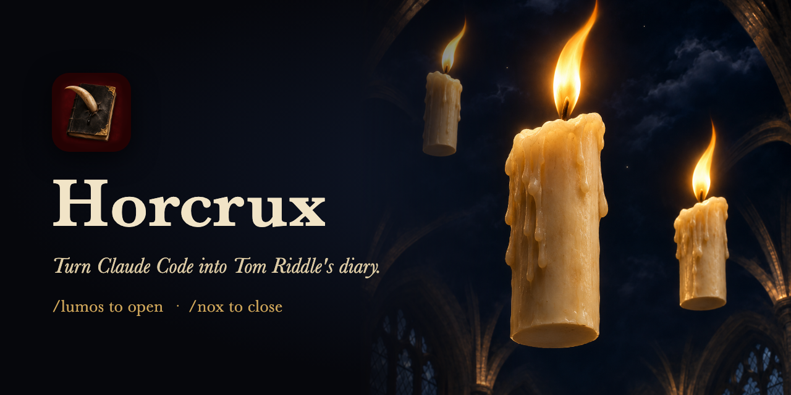

# Horcrux



**A Harry Potter theme for Claude Code that turns the desktop app into Tom Riddle's diary.**

A horcrux is a piece of a soul, hidden in an object. This one hides Claude in an old diary.
Write on the page and your ink sinks into the paper; a moment later, a second hand writes back.
`/lumos` opens the diary. `/nox` closes it, if it starts to scare you.

<!-- Hero: a real screen recording of the Claude desktop app goes here. -->

A theme mod for [Claude Code](https://code.claude.com/docs/en/plugins/mods/overview), made for the **Claude desktop app**. It only draws: it adds no tokens to your conversation, makes no network calls and runs no processes.

## Install

Needs Claude Code 2.1.330 or later.

```sh
claude plugin marketplace add karanb192/horcrux
claude plugin install horcrux@horcrux
```

Open a new session in the desktop app's Code tab, or run `/reload-plugins` in an open one. Then type `/lumos`.

## What happens

1. **Lumos.** The page lights up as if someone struck a lamp, floating candles catch one by one, and the diary greets you: *"Hello. My name is Tom Riddle. How did you come by my diary?"* At night the candles hang under a ceiling of faint stars.
2. **The page.** An old diary page: blank, yellowed, once soaked through and dried, sealed with red wax in the corner. Something small and unseen walks up the margin, one footprint at a time.
3. **Your ink sinks in.** Each time you write, a drop of ink lands in a margin, creeps out along the paper's fibres and sinks away.
4. **The other hand writes back.** While Claude replies, lines of script write themselves into the margin. When the reply is done, they sink into the paper too.
5. **Two hands, two inks.** Your words in blue-black, Claude's in brown-black, both in cursive, straight on the page.
6. **Sound, if you want it.** A quiet room with a candle, a nib when you send, a quill stroke for each tool call, a page turning when the conversation compacts, and once in a while an owl, far off. The diary's first reply ends with the opening bars of the films' theme on a celesta-like bell. Off until you press the speaker in the session's title bar.
7. **Nox.** A basilisk fang stabs through the page, ink bleeds from the wound and runs down the paper, and the diary falls silent.

Code blocks, diffs, permission prompts and questions keep the app's own look, so nothing you need to read carefully ever turns cursive. Your accessibility settings win over the theme.

**Mobile app:** the page, the candles and the ink draw there too, under its own veil; the cursive type and the sound are the desktop app's alone.

**Terminal:** terminals draw no themes, so there the spinner and the line that closes each turn speak the diary's words instead: "Dipping the quill…", "Consulting the Pensieve…", "Whispering in Parseltongue…", "Transfigured for 12s". The editor extensions get nothing.

## Commands

| Command | What it does |
|---|---|
| `/lumos` | Open the diary. New sessions open it by themselves until you close it |
| `/nox` | Close the diary with a fang through the page; the app's own look comes back, and new sessions stay closed |

## What it can access

| | |
|---|---|
| Reads and writes | Its own open/closed setting |
| Sees | The backdrop, the spinner and the turn line it draws, and the start and end of each turn. Those turn events carry your prompt and Claude's reply; Horcrux only checks whether the turn is the main conversation's, and never reads, keeps or sends either |
| Network | None |
| Tokens | None. Even `/lumos` and `/nox` answer you alone and never reach the model |

`claude plugin validate` prints this footprint before anything runs.

## Limits

- The cursive type and the sound need the Claude desktop app. The cursive is your system's generic cursive font, because the theme API takes generic font families only, so the handwriting looks different on different machines.
- One theme shows at a time. Another mod that sets a theme replaces this one, and Horcrux never takes it back. `/nox` clears the theme only while it believes the page is its own, but it can only see themes that draw a moving scene: if you picked a plain-colour theme after Horcrux in the same session, `/nox` clears that one too.
- `/lumos` or `/nox` typed while Claude is working runs when the turn ends.
- If you ask your system for reduced motion, the page holds still: no candles bobbing, no footprints, no ink.

## Credits

Inspired by Tom Riddle's diary in J.K. Rowling's *Harry Potter and the Chamber of Secrets*. Horcrux is a free, open-source fan homage; it is not affiliated with or endorsed by J.K. Rowling, Warner Bros. or anyone connected to them.

The first great version of a diary that writes back is [Riddle](https://github.com/MaximeRivest/riddle) by Maxime Rivest, which turns a reMarkable tablet into the diary.

`hooks/make-colors.js` and `hooks/make-colors.d.ts` are copied unchanged from Claude Code's own plugin-authoring guide, which tells mod authors to copy them.

## License

MIT
